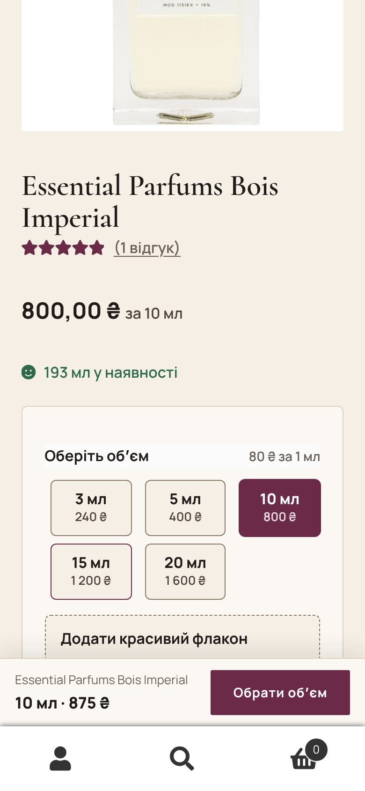

# Pshyk Rozpyv — бутик-редизайн и выбор объёма (локальная версия)

Редизайн магазина распива [pshykrozpyv.com](https://pshykrozpyv.com/) в виде **отдельного плагина WordPress** поверх текущего стека (WooCommerce + WoodMart + собственный плагин магазина). Сайт не изменялся: всё собрано и проверено на локальной копии с реальными товарами, ценами и отзывами из публичного каталога.

| | |
|---|---|
|  |  |

Больше экранов — в [`docs/screenshots/`](docs/screenshots/).

## Что внутри
- `pshyk-boutique/` — плагин (PHP 8, без зависимостей и сборки):
  - новая главная `[pshyk_home]`;
  - карточки с ценой минимального объёма;
  - выбор объёма кнопками + итог «аромат + флакон = разом»;
  - sticky-панель покупки на телефоне;
  - объём «мл» в корзине, оформлении и заказе;
  - поиск с опечатками и кириллицей;
  - строка активных фильтров;
  - украинские тексты вместо английских;
  - скрытие фиктивного счётчика просмотров.
- `staging/` — сборка локального стенда одной командой. Включает снимок 132 товаров/46 отзывов с фото и `mu-plugins/pshyk-store-shim.php` — **модель** наблюдаемого поведения плагина магазина (только для стенда).
- `docs/` — [аудит](docs/AUDIT.md), [концепция и токены](docs/DESIGN.md), [передача владельцу: установка, вопросы, следующие этапы](docs/HANDOFF.md).

## Запуск локально
Нужны PHP 8.1+ (pdo_sqlite, gd, intl, mbstring, zip), curl, unzip. MySQL и Docker не нужны.

```bash
bash staging/setup.sh 8080
```

```bash
php -S localhost:8080 -t staging/wordpress staging/router.php
```

Открыть http://localhost:8080/ (админка: `admin` / `admin-staging`). Оплата на стенде — тестовый «рахунок ФОП», письма не отправляются, а пишутся в `staging/wordpress/wp-content/debug.log`.
